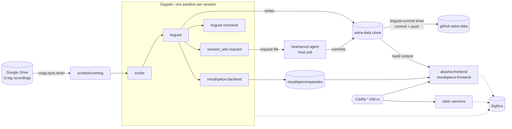

# Architecture

astra runs on one host. Dagster runs the session pipeline, Docker Compose runs the long-running
services, the shared host Caddy is the edge, and SigNoz collects traces, metrics and logs from all
of them. Production always builds from the deploy checkout at a pushed commit, and all runtime data
lives under one data root.



## Where things run

| Concern | Runs as | Defined in |
|---|---|---|
| Session pipeline (scribe, linguist, mouthpiece, chronicle, heartwood request) | Dagster assets, each run in its own container from the `astra-dagster` image (ADR 0030); `dagster-code` serves the definitions and evaluates sensors and schedules, `dagster-daemon` launches the runs | `dagster/definitions.py`, each app's `assets.py` |
| Long-running services (SSR frontends, Discord bots, overlay, render, portal, Postgres) | Docker Compose services, `restart: unless-stopped` with healthchecks | `deploy/docker-compose.yml` |
| Edge (TLS, reverse proxy) | The shared host Caddy at `/ruby/data/reverse-proxy`, which imports this repo's `sites.caddyfile` from the deploy checkout | `sites.caddyfile` |
| Observability | SigNoz (vendored compose include) and its OTel collector | `deploy/signoz/` |
| Host jobs | systemd user units linked from the deploy checkout | `deploy/systemd/` |
| CI | GitHub Actions; every job runs the `just` recipe of the same name | `.github/workflows/ci.yml` |

## Public hosts

All hosts are `*.iridi.cc` (a wildcard DNS record, so a new host needs no DNS change). Host ports
live in the 10350 to 10399 band.

| Host | Service | Port |
|---|---|---|
| `akasha.iridi.cc`, `heart.iridi.cc` | akasha-frontend (setting wiki, transcripts, chronicle) | 10365 |
| `api.akasha.iridi.cc` | Caddy file server over the astra-data linguist data | none |
| `mouthpiece.iridi.cc` | mouthpiece-frontend (recap podcast) | 10366 |
| `codex.iridi.cc`, `2e.iridi.cc` | codex (PF2e reference, noindexed) | 10374 |
| `strider.iridi.cc` | strider (faction map; editor is local network only) | 10360 |
| `vellum.iridi.cc` | vellum-frontend (document editor) and vellum-render (`/render`) | 10367, 10368 |
| `harrow.iridi.cc` | harrow (tarot reader) | 10369 |
| `ledger.iridi.cc` | ledger (landing page) | 10370 |
| `menhir.iridi.cc` | menhir (session-opener quiz) | 10375 |
| `weal-overlay.iridi.cc` | weal-overlay (dice overlay) | 10361 |
| `orator.iridi.cc` | orator-backend (music bot API and web UI) | 10363 |
| `portal.iridi.cc` | portal server (MCP bridge to FoundryVTT) | 10372 |
| `otel.iridi.cc` | OTel collector OTLP/HTTP, for browser RUM and desktop clients | 10353 |
| `signoz.iridi.cc`, `dagster.iridi.cc` | SigNoz and Dagster UIs (local network only) | 10351, 10350 |

Not edge-routed: weal-bot (Discord only), portal-headless (10373, health only), the three
Postgres instances, node-exporter and smart-exporter.

## Deploy checkout

Production builds only from `/ruby/data/astra-deploy`, a plain clone of the code repo. `just
deploy` (`deploy/deploy.sh`) moves it to `origin/main` or a pushed `--sha`, decrypts SOPS on the
host, passes each secret to its container as an upper-cased environment variable, and labels every
image with the commit, then waits for the containers to be healthy. A dirty checkout
or an unpushed commit is refused. Every host unit also runs
from this checkout. Details: [`deploy/README.md`](../deploy/README.md) and
[ADR 0033](adr/0033-deploy-checkout-and-just-deploy.md).

## Data root

All runtime data lives under `/ruby/data/astra-state` (`config.kdl` `data.root`), one flat
directory per service. No container mounts a code checkout. Bind mounts use the same absolute path
inside and outside the container, so a path read from config means the same thing everywhere. The
full layout is the comment on the `data` block in
[`ontology/ontology-config/config.kdl`](../ontology/ontology-config/config.kdl).

App and Dagster containers run as uid 1000, so files they write are owned by the host user. The
Postgres containers keep their own uid 70, and their data dirs must stay mode 0700.

## astra-data

The pipeline's published datasets live in a separate public repo, `github.com/jbassin/astra-data`,
cloned at `/ruby/data/astra-state/astra-data` (`config.kdl` `data.content-root`): linguist
transcripts, data and timeline; the mouthpiece episode catalog; the akasha wiki content and
snapshot; heartwood's run ledger; the entity registry. The bots commit and push only there; nothing
commits to the code repo automatically. akasha-frontend and mouthpiece-frontend bake these datasets
at build time from the clone's committed HEAD, passed as a Docker build context. Tests and CI use
`fixtures/astra-data/` instead. See [ADR 0035](adr/0035-astra-data-repo.md).

## Host units

| Unit | Trigger | Job |
|---|---|---|
| `craig-sync` | every 5 min | Copies new Craig zips from the Drive FUSE mount into `scribe/incoming` |
| `linguist-commit` | every 15 min and on a new episode | Commits and pushes new datasets in astra-data, then redeploys the frontends that bake them |
| `heartwood-request` | on a Dagster request file, hourly sweep | Runs the heartwood agent for a session and publishes its wiki edits |
| `astra-watchdog` | every 15 min | Checks the Drive mount, the timers, the NIC, backup and restore-test age and entity.kdl drift; repairs the Drive mount itself |
| `astra-alert@` | `OnFailure=` of the units above | Pages Discord directly, debounced per unit |
| `astra-backup` | nightly 03:30 | Snapshots Postgres, the data root and the SigNoz rules to the sda disk |
| `astra-restore-test` | weekly, Sunday 05:30 | Restores the newest snapshot into throwaway containers and verifies it |

Alerting has three paths: a SigNoz rule pages Discord on ERROR or FATAL logs, `astra-alert@` pages
when a host unit fails, and the watchdog pages when something is silently absent. Recovery steps are
in the [runbook](runbook.md).

## Code layout

```
apps/        apps/<domain>/<role>/: py (the uv member) or web, bot, overlay, render, controller,
             ingest (pnpm)
libs/py/     config, llm, observe, ontology, lexicon, sessions, vellum-lang (+ _smoke)
libs/ts/     config, observe, ontology, gothic, site-kit, content-build, backdrop, vellum-lang,
             codex-corpus, pg-migrate, weal-engine (the committed wasm build), weal-wire (+ _smoke)
libs/rust/   weal-engine, the only Rust in the repo
ontology/    ontology-config (config.kdl and its schema), ontology-being (players, campaigns,
             hosts), ontology-entity (the setting's entity registry)
dagster/     the Dagster code location
deploy/      compose, deploy.sh, systemd units, SigNoz, SOPS
fixtures/    committed test data, including fixtures/astra-data/
docs/        living docs; thoughts/ holds memory, the live plan and the archive
```
